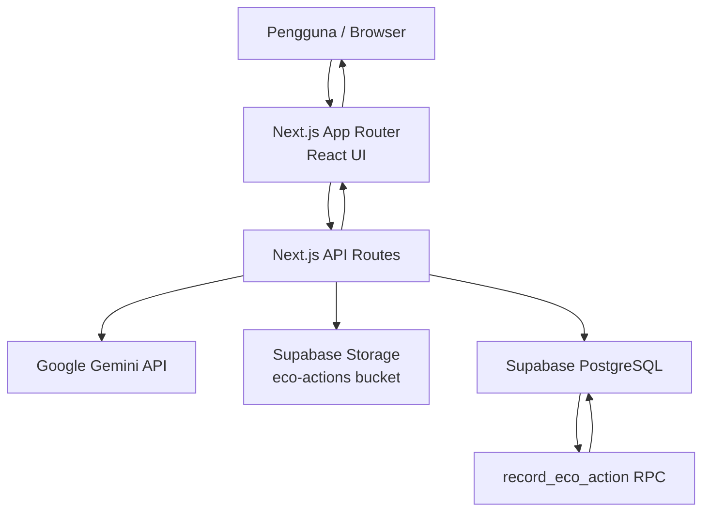
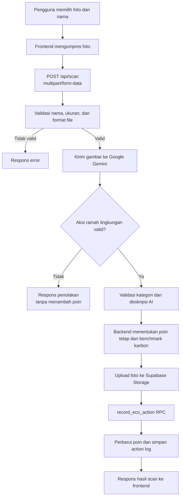

# EcoPassport AI 🌱

**Small Actions, Greener Future.**

EcoPassport AI adalah aplikasi web yang mendorong kebiasaan ramah lingkungan melalui pencatatan aksi hijau berbasis foto. Pengguna mengunggah foto aktivitas, AI membantu memvalidasi apakah foto menunjukkan aksi ramah lingkungan, lalu aplikasi menampilkan skor, estimasi penghematan karbon, poin hijau, riwayat cap, dan papan peringkat.

> Project demonstrasi untuk LOGICODIX 2026 — Green Environment & Sustainability.

## Daftar Isi

- [Pengenalan Projek](#pengenalan-projek)
- [Fitur Utama](#fitur-utama)
- [Tech Stack](#tech-stack)
- [Technical Documentation](#technical-documentation)
- [Frontend Documentation](#frontend-documentation)
- [Backend Documentation](#backend-documentation)
- [Database Schema](#database-schema)
- [Menjalankan di Localhost](#menjalankan-di-localhost)
- [Environment Variables](#environment-variables)
- [Catatan dan Batasan Implementasi](#catatan-dan-batasan-implementasi)

## Pengenalan Projek

### Latar Belakang

Kebiasaan ramah lingkungan dapat dimulai dari tindakan sederhana, seperti membawa tumbler, memilah sampah, bersepeda, menggunakan tas belanja kain, dan menghemat listrik. Namun, aktivitas tersebut sering kali belum terdokumentasi atau belum memberikan umpan balik yang mendorong pengguna untuk terus melakukannya.

EcoPassport AI menghadirkan pendekatan gamifikasi: pengguna mengirim foto aktivitas, memperoleh hasil analisis berbantuan AI, dan mengumpulkan poin sebagai bentuk apresiasi atas aksi hijau.

### Solusi

EcoPassport AI menggabungkan antarmuka web, Google Gemini, dan Supabase. Hasil analisis foto ditampilkan sebagai cap digital pada paspor hijau pengguna. Poin yang terkumpul digunakan untuk menampilkan level, lencana, hadiah berbasis ambang poin, serta peringkat komunitas.

### Target Pengguna

- Pelajar dan mahasiswa yang ingin membangun kebiasaan ramah lingkungan.
- Individu yang ingin mencatat aktivitas hijau secara sederhana.
- Komunitas atau kelompok edukasi lingkungan yang ingin memperkenalkan aksi keberlanjutan melalui gamifikasi.

## Fitur Utama

- **AI Scan Eco Action** — unggah foto JPG, PNG, atau WEBP untuk dianalisis oleh Google Gemini.
- **Green Points** — aksi valid memperoleh poin tetap berdasarkan kategori yang ditentukan backend; Gemini tidak menentukan poin.
- **Estimasi Penghematan Karbon** — menggunakan benchmark kategori yang ditentukan backend. Nilai hanya ditampilkan jika asumsi yang tersedia mendukung estimasi; kategori tanpa data kuantitatif yang cukup ditampilkan 0 kg disertai alasan.
- **Paspor dan Riwayat Aksi** — menampilkan total poin, riwayat cap, level, streak, dan lencana.
- **Leaderboard** — menampilkan 10 pengguna dengan poin tertinggi serta podium tiga peringkat teratas.
- **Rewards** — menampilkan hadiah berdasarkan ambang poin dan kode klaim yang dibuat di sisi aplikasi.

## Tech Stack

| Bagian | Teknologi |
|---|---|
| Framework web | Next.js 15.0.7 (App Router) |
| UI | React 18.3.1 |
| Styling | Tailwind CSS 4 |
| Icon | Lucide React |
| AI | Google Gemini melalui `@google/genai` |
| Database | Supabase PostgreSQL |
| File storage | Supabase Storage |
| Bahasa | JavaScript dan TypeScript/TSX |
| Runtime | Node.js |

Versi dependency mengacu pada `package.json`.

## Technical Documentation

### Arsitektur Sistem

Aplikasi menggunakan Next.js App Router. Browser merender halaman dan mengirim request ke API Route di Next.js. API Route memproses permintaan di server, berkomunikasi dengan Gemini untuk analisis foto, lalu menggunakan Supabase untuk penyimpanan file dan data.



### Diagram Alur AI Scan



### Alur Data Halaman

- Halaman beranda mengambil data peringkat melalui `GET /api/leaderboard`.
- Halaman Scan mengirim foto ke `POST /api/scan`.
- Halaman Paspor mengambil ringkasan pengguna dan riwayat melalui `GET /api/user?name=...`.
- Halaman Peringkat mengambil data leaderboard dan, jika nama pengguna tersedia, mengambil ringkasan pengguna.

## Frontend Documentation

### Framework dan UI

Frontend dibangun dengan Next.js App Router dan React. Styling menggunakan Tailwind CSS v4 serta CSS global pada `app/globals.css`. Ikon antarmuka menggunakan Lucide React. Font aplikasi dimuat melalui `next/font/google` dengan Fredoka untuk heading dan Nunito untuk teks.

### Struktur Halaman

| Path | Kegunaan |
|---|---|
| `app/page.tsx` | Beranda, penjelasan cara kerja, ringkasan leaderboard |
| `app/upload/page.js` | Pemilihan foto, proses AI Scan, dan hasil analisis |
| `app/leaderboard/page.js` | Peringkat pengguna dan tampilan rewards |
| `app/profile/page.js` | Paspor, statistik, level, lencana, dan riwayat aksi |

### Komponen UI

Komponen reusable berada di folder `components/`, antara lain:

- `Navbar.js` — navigasi desktop dan bottom navigation mobile.
- `UserProvider.js` — context nama pengguna dan penyimpanan nama di localStorage.
- `Stamp.js` — tampilan cap digital untuk aksi dan poin.
- `Avatar.js` — avatar pengguna.
- `Ornaments.js` — ornamen SVG dekoratif.
- `Confetti.js` dan `CountUp.js` — elemen animasi dan angka.

Logika pendukung seperti level, streak, lencana, reward, kompresi foto, dan konversi estimasi karbon berada di `lib/eco.js`.

### Aset

- Aset statis aplikasi diletakkan di folder `public/`.
- Ornamen dekoratif SVG dibuat sebagai komponen pada `components/Ornaments.js`.
- Ikon antarmuka menggunakan paket `lucide-react`.

## Backend Documentation

### API Endpoints

Base URL lokal: `http://localhost:3000`.

| Method | Endpoint | Input | Fungsi |
|---|---|---|---|
| POST | `/api/scan` | `multipart/form-data`: `image`, `user_name` | Validasi foto, analisis Gemini, simpan foto ke Storage, lalu simpan aksi dan poin melalui RPC |
| GET | `/api/leaderboard` | — | Mengambil peringkat pengguna berdasarkan `green_points`; mengembalikan maksimal 10 data dan podium |
| GET | `/api/user?name={nama}` | Query `name` (wajib, maksimal 24 karakter) | Mengambil poin pengguna dan riwayat aktivitasnya |

#### Ringkasan Request dan Response

**POST `/api/scan`**

- Content type: `multipart/form-data`.
- Field wajib: `image` (JPG/PNG/WEBP, maksimal 10 MB) dan `user_name` (maksimal 24 karakter).
- Jika valid, respons memuat `success`, `action_category`, `category_label`, `score` (poin tetap dari backend), `carbon_saved` (benchmark backend), `carbon_method`, `carbon_note`, `action_title`, `message`, `image_url`, dan data log.
- Jika foto tidak valid sebagai aksi hijau, respons memuat `success: false` dan `is_valid: false`.

**GET `/api/user?name=...`**

- `name` wajib diisi; nama kosong tidak diarahkan ke profil contoh.
- Nama dipangkas spasi tepinya dan divalidasi konsisten dengan nama pada permintaan scan.

**GET `/api/leaderboard`**

- Respons sukses memuat `success`, `total_users`, `data`, dan `podium`.
- Data diurutkan berdasarkan poin tertinggi. Pengguna dengan poin sama memperoleh peringkat yang sama.

**GET `/api/user?name=...`**

- Respons sukses memuat objek `user` (nama, poin, total aksi) dan array `logs` (riwayat aksi).

### Struktur Folder Backend

- `app/api/scan/route.js` — endpoint analisis foto dan pencatatan aksi.
- `app/api/leaderboard/route.js` — endpoint data peringkat.
- `app/api/user/route.js` — endpoint data pengguna dan riwayat.
- `lib/api.js` — helper fetch dari frontend ke API routes.
- `lib/supabase.js` — inisialisasi Supabase Admin Client.
- `lib/server-errors.js` — helper pencatatan error server.
- `supabase/migrations/20261112000000_record_eco_action.sql` — definisi RPC pencatatan aksi secara transaksional.

## Database Schema

Database menggunakan Supabase PostgreSQL. Berdasarkan query pada kode aplikasi dan migration RPC, tabel yang digunakan adalah:

### Tabel `users`

| Kolom | Kegunaan |
|---|---|
| `id` | Identitas pengguna; digunakan untuk identifikasi dan pengurutan |
| `name` | Nama pengguna yang ditampilkan |
| `green_points` | Total poin hijau |
| `created_at` | Waktu pembuatan data pengguna |

### Tabel `action_logs`

| Kolom | Kegunaan |
|---|---|
| `id` | Identitas catatan aksi |
| `user_name` | Nama pengguna pemilik catatan aksi |
| `image_url` | URL foto aksi pada Supabase Storage |
| `score` | Skor/poin dari hasil analisis |
| `carbon_saved` | Estimasi karbon yang dihemat (kg CO₂) |
| `action_title` | Judul aksi hasil analisis AI |
| `created_at` | Waktu pencatatan aksi |

### Database Function / RPC

`record_eco_action(p_user_name, p_image_url, p_score, p_carbon_saved, p_action_title)`

RPC ini memperbarui atau membuat data pengguna, menambahkan poin, dan menyimpan catatan aksi dalam satu transaksi database. Eksekusi function dibatasi untuk role `service_role`.

> **Catatan skema:** migration yang tersedia di repository mendefinisikan RPC `record_eco_action`, bukan keseluruhan DDL pembuatan tabel `users` dan `action_logs`. Nama kolom di atas didokumentasikan dari pemakaian aktual di kode dan RPC. Untuk instalasi database baru, schema dasar kedua tabel harus disediakan/diinisialisasi terlebih dahulu.

RPC membatasi skor per aksi ke rentang 1–100. Aplikasi saat ini memberi 10 atau 15 poin deterministik berdasarkan kategori aksi yang telah divalidasi; nilai tersebut adalah poin gamifikasi, bukan ukuran dampak lingkungan.

### Supabase Storage

- Nama bucket: `eco-actions`.
- Foto disimpan menggunakan nama objek berbasis SHA-256 dari isi file.
- API mengambil public URL foto setelah upload berhasil.

## Menjalankan di Localhost

### Prasyarat

- Node.js versi LTS yang kompatibel dengan Next.js 15.
- npm.
- Akun/proyek Supabase.
- Google Gemini API key.

### 1. Clone Repository

```bash
git clone https://github.com/yosefin05/ecopassport.git
cd ecopassport
```

### 2. Install Dependencies

```bash
npm install
```

### 3. Siapkan Environment Variables

Salin file contoh:

**Windows PowerShell**
```powershell
Copy-Item .env.example .env.local
```

**macOS / Linux**
```bash
cp .env.example .env.local
```

Isi nilai environment sesuai proyek Supabase dan Google Gemini milik sendiri. Jangan mengunggah `.env.local` ke GitHub.

### 4. Siapkan Supabase

1. Buat atau gunakan proyek Supabase.
2. Pastikan tabel `users` dan `action_logs` tersedia dengan kolom yang dijelaskan pada bagian Database Schema.
3. Buat bucket Storage bernama `eco-actions` dengan konfigurasi akses yang sesuai kebutuhan aplikasi.
4. Buka SQL Editor di Supabase.
5. Jalankan isi file `supabase/migrations/20261112000000_record_eco_action.sql` untuk membuat RPC `record_eco_action`.

Migration RPC tidak dijalankan otomatis oleh `npm install`.

### 5. Jalankan Development Server

```bash
npm run dev
```

Buka [http://localhost:3000](http://localhost:3000).

### 6. Build untuk Pemeriksaan

```bash
npm run build
```

## Environment Variables

Lihat [.env.example](.env.example) untuk template variabel. Semua variabel di bawah dibaca oleh backend/server:

| Variable | Kegunaan |
|---|---|
| `GEMINI_API_KEY` | API key Google Gemini untuk analisis foto |
| `NEXT_PUBLIC_SUPABASE_URL` | URL proyek Supabase |
| `SUPABASE_SERVICE_ROLE_KEY` | Service role key untuk operasi Supabase dari server |

**Penting:** `SUPABASE_SERVICE_ROLE_KEY` adalah rahasia server. Jangan menambahkan prefix `NEXT_PUBLIC_`, jangan menggunakannya di komponen client, dan jangan pernah mengunggah nilai aslinya ke repository publik.

## Benchmark dan Transparansi Perhitungan

| Kategori | Poin tetap | Benchmark karbon | Catatan |
|---|---:|---:|---|
| Botol pakai ulang | 10 | 0,033 kg CO₂ | Asumsi satu kali penggunaan ulang botol 500 ml |
| Pemilahan sampah | 15 | 0 kg | Foto tidak menunjukkan jenis/berat material dan proses pengolahan |
| Bersepeda | 15 | 0 kg | Foto tidak membuktikan jarak atau kendaraan yang digantikan |
| Tas pakai ulang | 10 | 0 kg | Manfaat bergantung pada jenis tas dan jumlah pemakaian ulang |
| Hemat energi | 10 | 0 kg | Foto tidak menunjukkan energi yang dihemat dalam kWh |

Poin 10/15 merupakan keputusan gamifikasi produk, bukan ukuran dampak lingkungan. Benchmark botol mengacu pada estimasi penghematan 0,033 kg CO₂ untuk satu kali penggunaan ulang botol PET 500 ml pada studi *Making the Environmental Case for Reusable PET Bottles* oleh Hamade, Hadchiti, dan Ammouri, *Procedia Manufacturing* 43 (2020), hlm. 201–207, DOI: 10.1016/j.promfg.2020.02.137. Nilai ini merupakan acuan ilustratif dari studi tersebut dan tidak mewakili semua jenis/material botol. Sumber: https://www.sciencedirect.com/science/article/pii/S2351978920307174.

## Catatan dan Batasan Implementasi

- Identitas pengguna saat ini menggunakan nama yang disimpan di browser (`localStorage`), belum menggunakan sistem login atau autentikasi akun.
- Nama pengguna dikirim dari frontend ke API; validasi alias tidak membuktikan kepemilikan identitas. Pengguna dapat mengklaim nama orang lain, sehingga autentikasi diperlukan sebelum leaderboard atau poin digunakan untuk produksi.
- Gemini hanya mengklasifikasikan bukti visual dan memberi deskripsi singkat. Poin tetap dan benchmark karbon ditentukan backend, bukan oleh AI. Estimasi karbon bersifat terbatas: satu kali penggunaan ulang botol 500 ml memakai benchmark 0,033 kg CO₂; kategori lain belum diberi angka karena foto saja tidak membuktikan jarak, berat material, jumlah penggunaan ulang, atau energi (kWh). Nilai tersebut bukan pengukuran langsung.
- Hadiah dan kode klaim dibuat dari konfigurasi frontend. Repository saat ini belum menunjukkan endpoint backend untuk penukaran atau verifikasi hadiah.
- Schema dasar tabel Supabase tidak disertakan sebagai migration pembuatan tabel pada repository ini; lihat catatan pada bagian Database Schema.

---

Dibuat untuk mendorong aksi kecil yang membawa perubahan lebih hijau. 🌍
